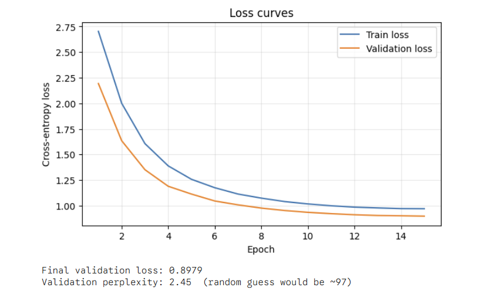
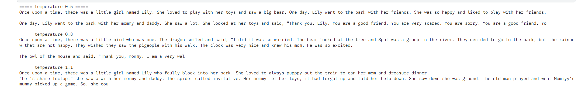
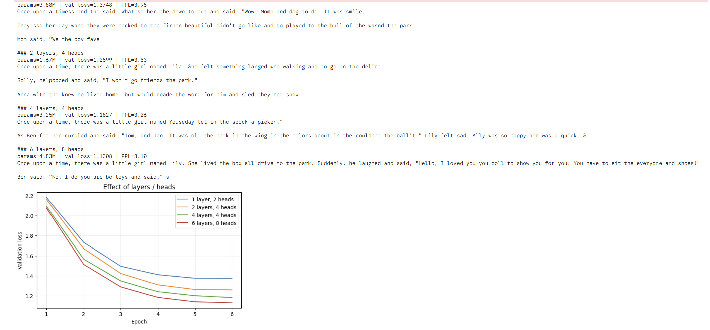
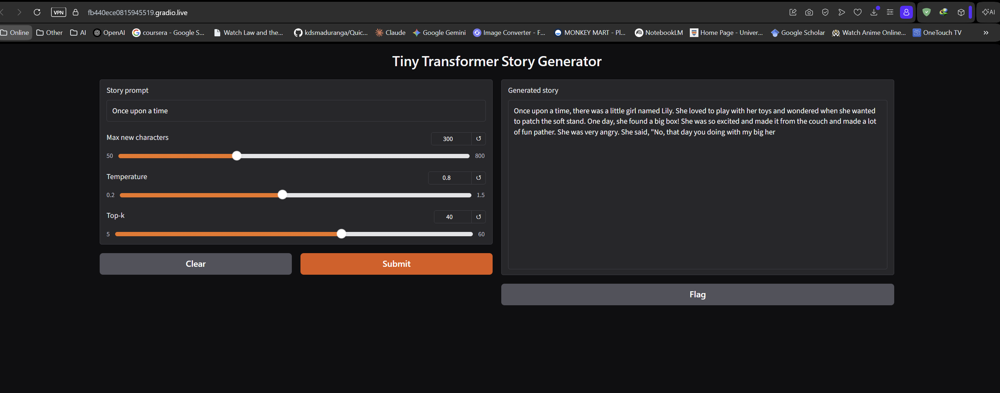

# Lab 03: Tiny Transformer Language Model

## Objective
Build, train and evaluate a small decoder-only Transformer (GPT style) on the TinyStories dataset to predict the next character and generate short stories.

## Dataset
[roneneldan/TinyStories](https://huggingface.co/datasets/roneneldan/TinyStories) from Hugging Face. 20,000 training stories and 2,000 validation stories were used. Text was tokenized at the character level (vocabulary size 97), giving about 17.9M training characters.

## What I Did
1. Loaded and explored the dataset (example stories and story length distribution)
2. Preprocessed the text with a character-level tokenizer
3. Created input sequences (256 characters) and next-character targets
4. Built the Transformer: token and positional embeddings, masked multi-head self-attention, feed-forward layers, residual connections and layer normalization
5. Initialized the model (3.25M parameters) with cross-entropy loss and the AdamW optimizer
6. Trained for 15 epochs and recorded training and validation loss
7. Evaluated validation loss and perplexity
8. Generated stories from the prompt "Once upon a time" at different temperatures
9. Experimented with the number of layers, attention heads and epochs
10. Saved the model and configuration
11. Built a Gradio chat window (optional task)

## Notebook
- GitHub: [Lab-03-Tiny-Transformer.ipynb](./notebooks/Lab-03.ipynb)
- Kaggle: [Run on Kaggle](https://www.kaggle.com/code/ashendulanjaya/lab-03)

## Environment
- Platform: Kaggle Notebook with GPU T4
- Libraries: PyTorch, NumPy, Matplotlib, pandas, Hugging Face `datasets`, Gradio

## Model Configuration
| Setting | Value |
|---------|-------|
| Layers | 4 |
| Attention heads | 4 |
| Embedding size | 256 |
| Context length | 256 characters |
| Dropout | 0.1 |
| Parameters | 3.25M |
| Optimizer | AdamW with cosine learning rate schedule |

## Results

**Final model (15 epochs):** validation loss 0.898, validation perplexity 2.45. A random guess would give a perplexity of about 97.

### Generated Story

### Experiments: Layers and Heads (6 epochs each)

| Model | Parameters | Validation loss | Perplexity |
|-------|-----------|-----------------|-----------|
| 1 layer, 2 heads | 0.88M | 1.375 | 3.95 |
| 2 layers, 4 heads | 1.67M | 1.260 | 3.53 |
| 4 layers, 4 heads | 3.25M | 1.183 | 3.26 |
| 6 layers, 8 heads | 4.83M | 1.131 | 3.10 |

### Experiments: Number of Epochs

| Epochs | Validation loss | Perplexity |
|--------|-----------------|-----------|
| 3 | 1.577 | 4.84 |
| 8 | 1.081 | 2.95 |
| 15 | 0.890 | 2.44 |

### Gradio Chat Window

## Key Learnings
- Next-token prediction is enough for a model to learn the style of simple stories.
- Masked (causal) self-attention stops the model from seeing future characters.
- Larger models and more training epochs lowered the loss.
- Lower temperature gives safer text, and higher temperature gives more varied text with more mistakes.

## Mechanisms That Improve Performance
Self-attention and multiple heads capture context, positional embeddings give word order, residual connections and layer normalization stabilize training, and dropout and weight decay reduce overfitting. AdamW with a cosine learning rate schedule and mixed precision (fp16) make training faster and more stable.

## Challenges & Limitations
- The model works character by character and is very small, so stories are not fully coherent.
- Training was limited to a subset of the data and a few epochs because of the GPU time limit.

## Files in This Lab
- `notebooks/` : the Kaggle notebook exported as .ipynb
- `results/` : plots and screenshots
