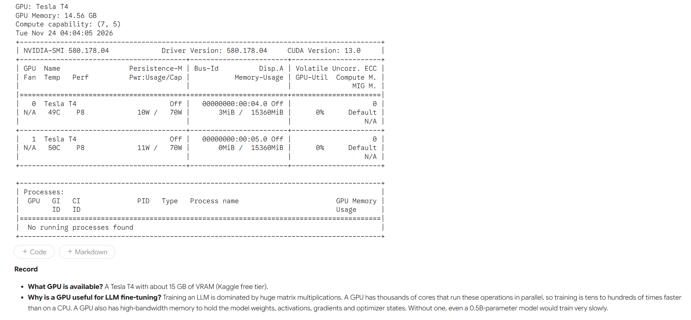
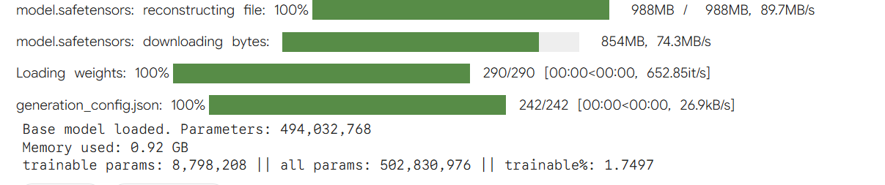
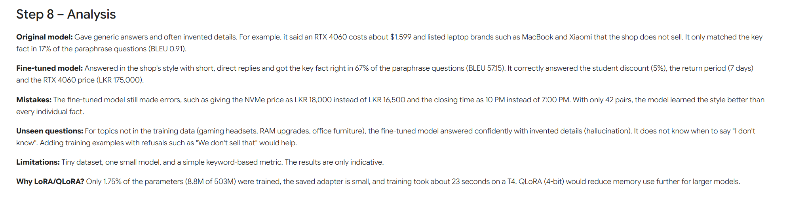

# Lab 04
## Objective
Fine-tune a small instruction-tuned language model on a custom question-and-answer dataset for a computer shop, and compare it with the original model.

## Model and Method
| Item | Choice |
|------|--------|
| Base model | Qwen/Qwen2.5-0.5B-Instruct (494M parameters) |
| Method | LoRA with PEFT (QLoRA 4-bit is supported in the code via `USE_QLORA`) |
| Trainer | TRL `SFTTrainer` |
| Domain | Customer-service assistant for "TechNova Computer Shop" |
| Platform | Kaggle Notebook, Tesla T4 GPU (14.56 GB) |

## Dataset
42 question-and-answer pairs about a fictional computer shop (opening hours, prices, returns, brands, repairs and more). Each question gets 2 reworded copies, giving **126 training examples**. Loss is computed only on the answer tokens.

## What I Did
1. Installed transformers, datasets, peft, trl, accelerate and bitsandbytes
2. Checked the GPU (Tesla T4)
3. Chose Qwen2.5-0.5B-Instruct
4. Created the dataset of 42 Q&A pairs
5. Configured LoRA: 8.8M trainable parameters out of 503M (1.75%)
6. Fine-tuned with SFTTrainer for 4 epochs (training loss 0.456, about 23 seconds)
7. Compared the original and fine-tuned models on the same questions, including questions not in the training data

## Notebook
- GitHub: [Lab-04-Fine-Tune.ipynb](./notebooks/Lab-04.ipynb)
- Kaggle: [Run on Kaggle](https://www.kaggle.com/code/ashendulanjaya/lab-04)

## Environment
- Kaggle Notebook with GPU T4 x1 and Internet on
- Libraries: transformers, datasets, peft, trl, accelerate, bitsandbytes, sacrebleu

## GPU Check
A Tesla T4 with about 15 GB of memory. A GPU is useful for fine-tuning because training is mostly large matrix multiplications that run in parallel on thousands of GPU cores, and its fast memory holds the weights, gradients and optimizer states.

## Training

## Results: Original vs Fine-Tuned

| Metric (6 paraphrase questions) | Original | Fine-tuned |
|---------------------------------|----------|-----------|
| Key-fact accuracy | 17% | 67% |
| BLEU score | 0.91 | 57.15 |

### Example answers
| Question | Original model | Fine-tuned model |
|----------|---------------|------------------|
| Is there a student offer on laptops? | Says it has no access to offers | Students get a 5% discount with a valid student ID |
| How many days to return an unopened item? | Generic 30 to 60 day advice | 7 days with the receipt |
| What is the price of an RTX 4060 card? | About $1,599 | LKR 175,000 |

## Analysis
- The original model gave generic answers and invented details.
- The fine-tuned model learned the shop's style and facts, answering 67% of the paraphrase questions correctly.
- It still made some mistakes, such as giving the NVMe price as LKR 18,000 instead of 16,500 and the closing time as 10 PM instead of 7 PM.
- On unseen topics (gaming headsets, RAM upgrades, office furniture) it made up confident answers, which is hallucination. Adding refusal examples such as "We don't sell that" would help.

## Key Learnings
- LoRA trains only about 1.75% of the parameters, so fine-tuning is fast and cheap.
- A small dataset teaches the style more reliably than every fact.
- The original model must be tested before the adapter is attached, otherwise the comparison is unfair.
- Fine-tuned models can hallucinate on topics outside their training data.

## Limitations
Tiny dataset (42 pairs), one small model, and a simple keyword-based metric, so the results are only indicative.

## Files in This Lab
- `notebooks/` : the Kaggle notebook exported as .ipynb
- `screenshots/` : GPU check, training and comparison results
