# Lab 06: Building Tool-Using AI Agents with Ollama

## Objective
Build AI agents that use tools: a calculator, desktop tools, memory, RAG search over university documents, and Google Calendar. Then build a similar agent with n8n workflow automation.

## Tech Stack
| Component | Tool |
|-----------|------|
| LLM | Llama 3.2 3B via Ollama |
| Agent framework | LangChain (tool calling with `bind_tools`) |
| Memory | SQLite (long-term) and a conversation list (short-term) |
| Knowledge base | PDF handbook with Qwen3 embeddings |
| Calendar | Google Calendar API (OAuth) |
| Workflow automation | n8n (Docker) |

## Part A: Tool-Using Agent
`agent.py` defines tools and runs an agent loop where the model picks a tool, the tool runs, and the result is returned to the model.

| Tool | What it does |
|------|--------------|
| `open_calculator` | Opens Windows Calculator and types the expression |
| `get_date_time` | Returns the current date and time |
| `open_notepad` | Opens Notepad and writes text |
| `search_files` | Finds files by name or extension in a folder |
| `create_file` | Creates a text file with given content |
| `system_info` | Returns OS, processor and memory information |

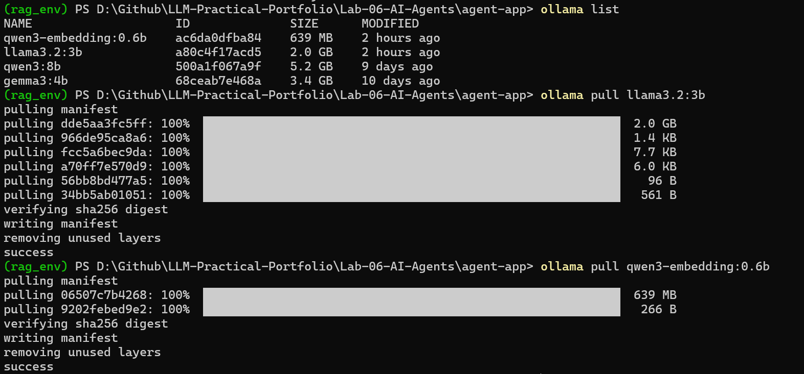
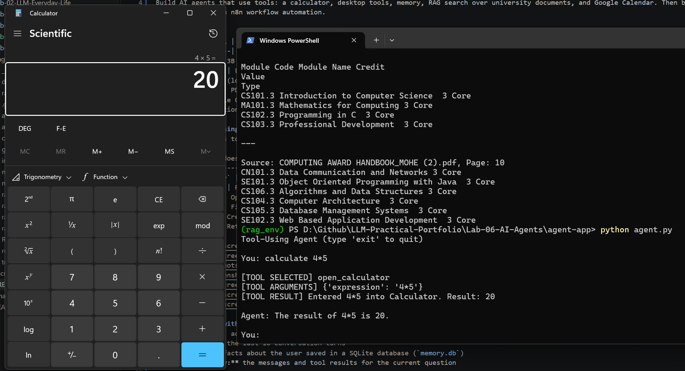
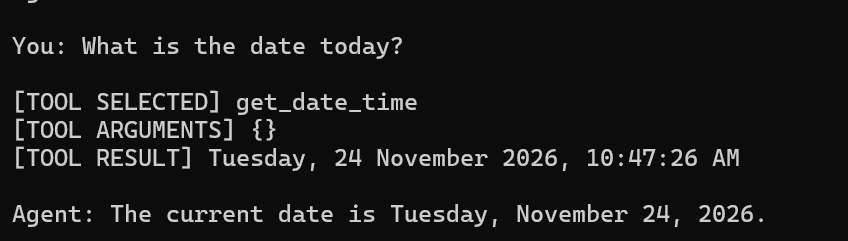
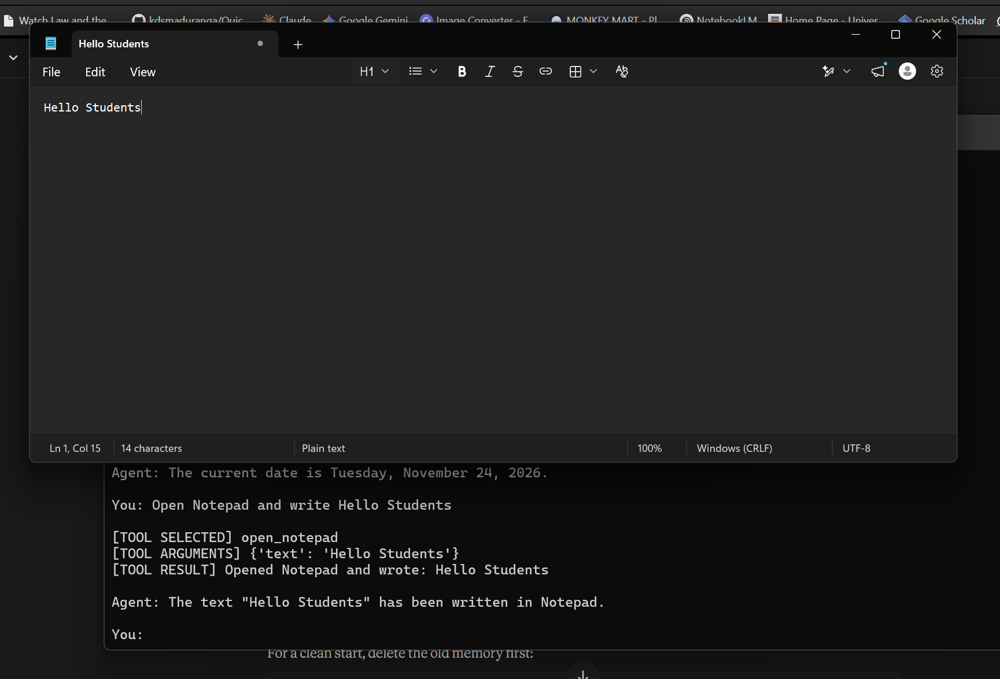
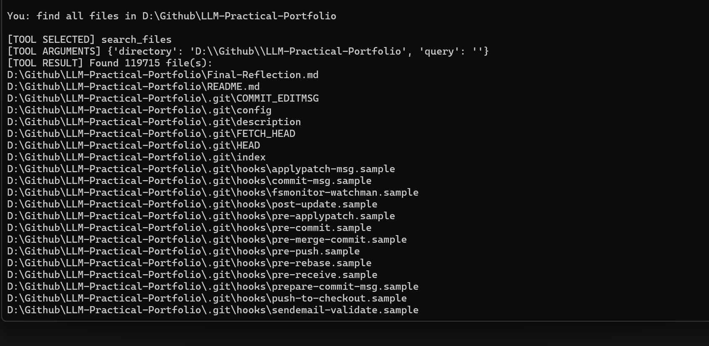
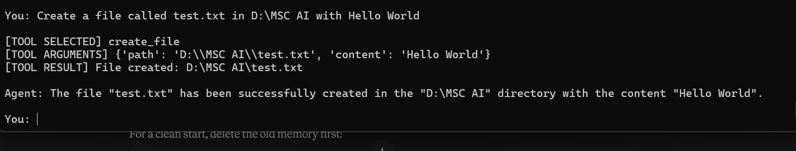
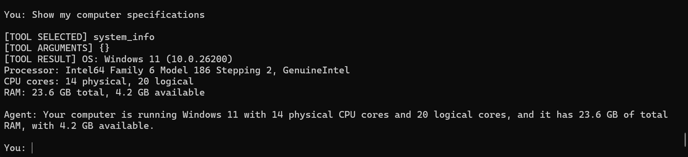

## Part B: Agent with Memory
`mem_rag_agent.py` adds three kinds of memory:
- **Short-term:** the last 10 conversation turns
- **Long-term:** facts about the user saved in a SQLite database (`memory.db`)
- **Working memory:** the messages and tool results for the current question

A `search_student_memory` tool lets the agent recall saved facts, such as the user's name.

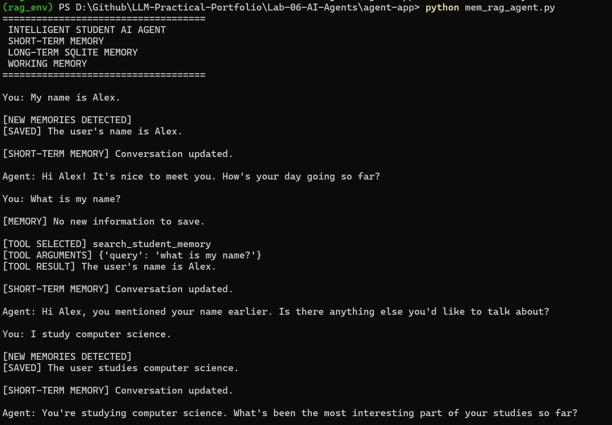
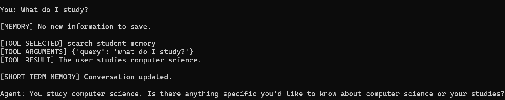

## Part C: RAG-Powered Agent
`rag_tool.py` reads PDFs from `data/`, splits them into chunks, embeds them with Qwen3 Embedding, and stores the vectors. The `search_university_knowledge` tool returns the most similar chunks (with source file and page) so the agent can answer university questions.

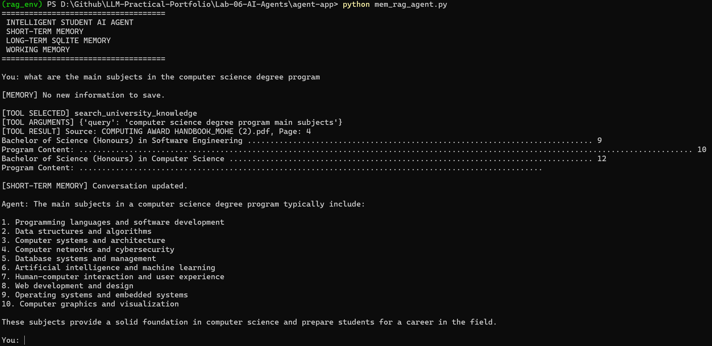

## Part D: Google Calendar Tools
`gcal_tools.py` adds `check_schedule` and `create_calendar_event` using the Google Calendar API with OAuth. `credentials.json` and `token.json` are private and are not included in this repository.

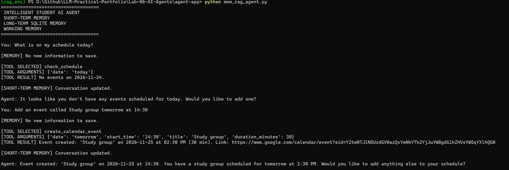
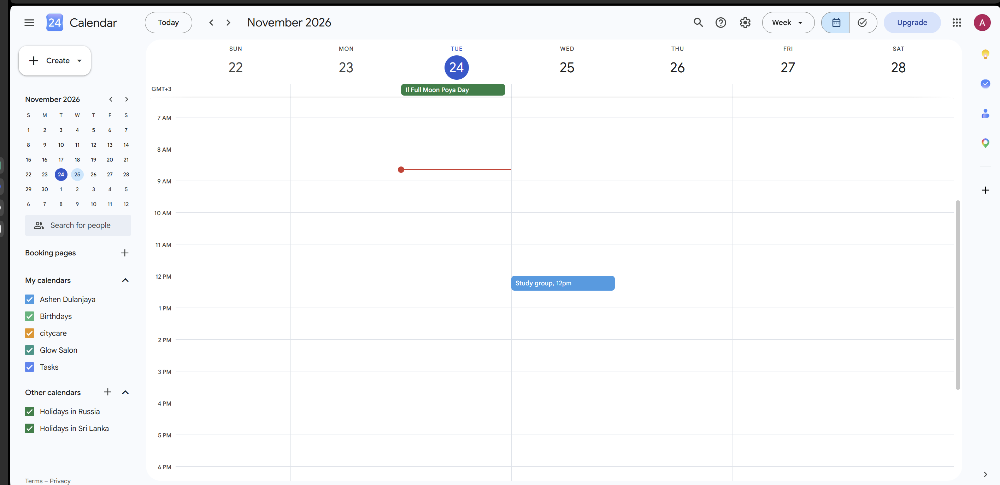

## Part E: n8n Workflow
An n8n AI Agent workflow running in Docker with a local Ollama model, Simple Memory and two Google Calendar tools (get events, create event). The exported workflow is in (My workflow.json).

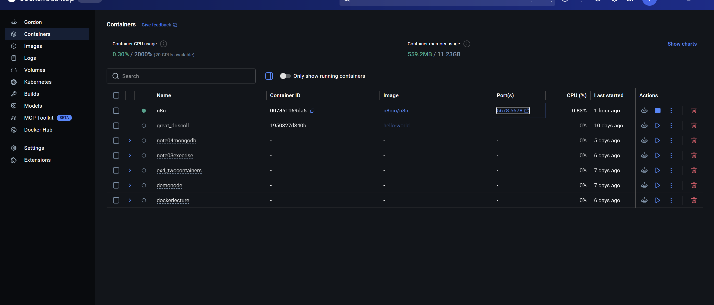
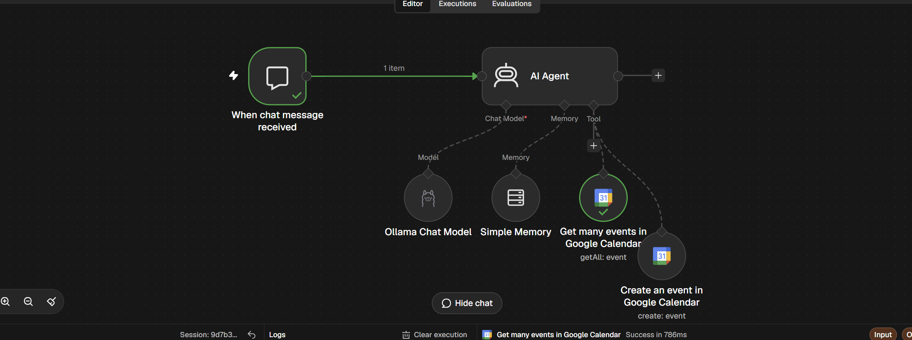
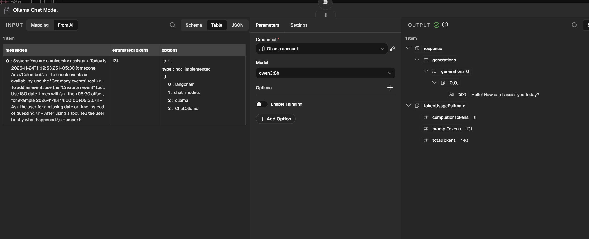
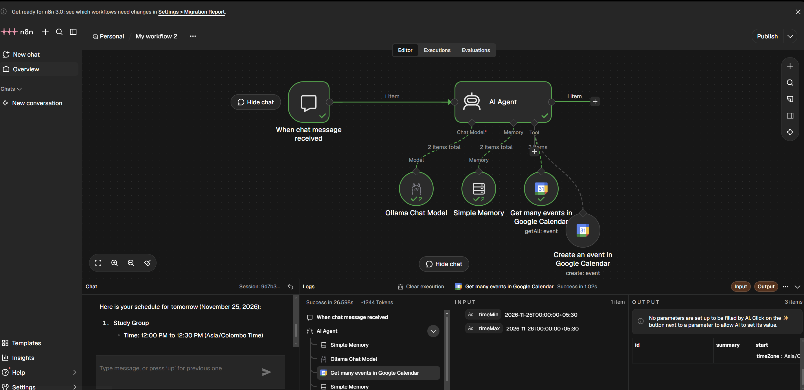

## How to Run
```powershell
py -3.12 -m venv rag_env
.\rag_env\Scripts\Activate.ps1
pip install -r requirements.txt

ollama pull llama3.2:3b
ollama pull qwen3-embedding:0.6b

python rag_tool.py build      # index the PDFs in ./data
python agent.py               # Part A tools
python mem_rag_agent.py       # Parts B, C and D
```
For Google Calendar, create an OAuth Desktop client in Google Cloud, save it as `credentials.json` in the same folder, and add yourself as a test user.

## Key Learnings
- An agent lets the LLM choose a tool, run it and use the result, instead of only generating text.
- Clear tool descriptions and a strict system prompt make a small model choose the right tool.
- Memory lets an agent remember user information across turns and sessions.
- RAG as a tool lets the agent look up documents only when needed.
- OAuth keeps Google access secure, and the credential files must never be committed.

## Limitations
- The 3B model sometimes picks the wrong tool or the wrong arguments.
- Calculator and Notepad automation (pyautogui) only works on Windows with the screen visible.
- Memory extraction uses simple patterns, so it does not capture every type of fact.

## Files in This Lab
- `agent-app/` : Python agents and tools
- `n8n-workflow/` : exported n8n workflow
- `screenshots/` : results of each part
