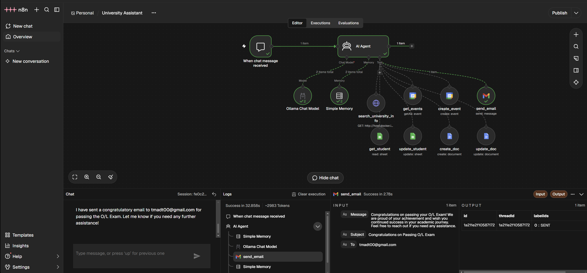
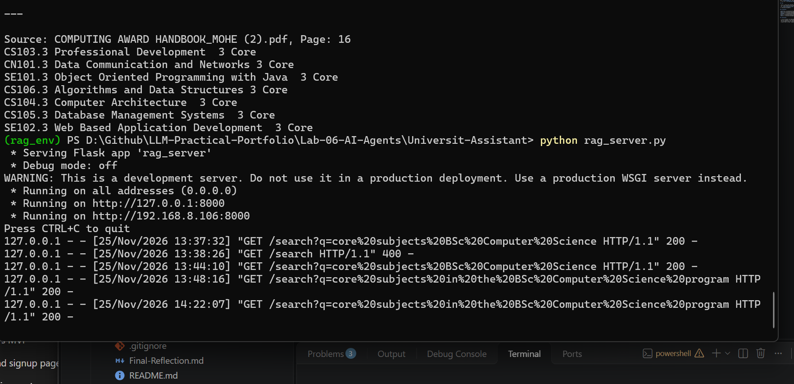
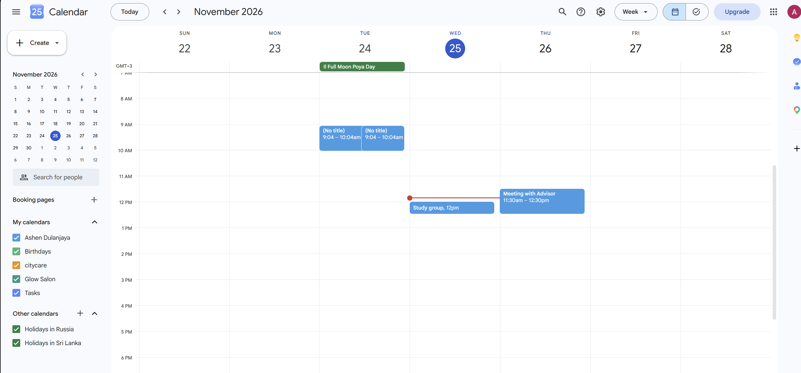
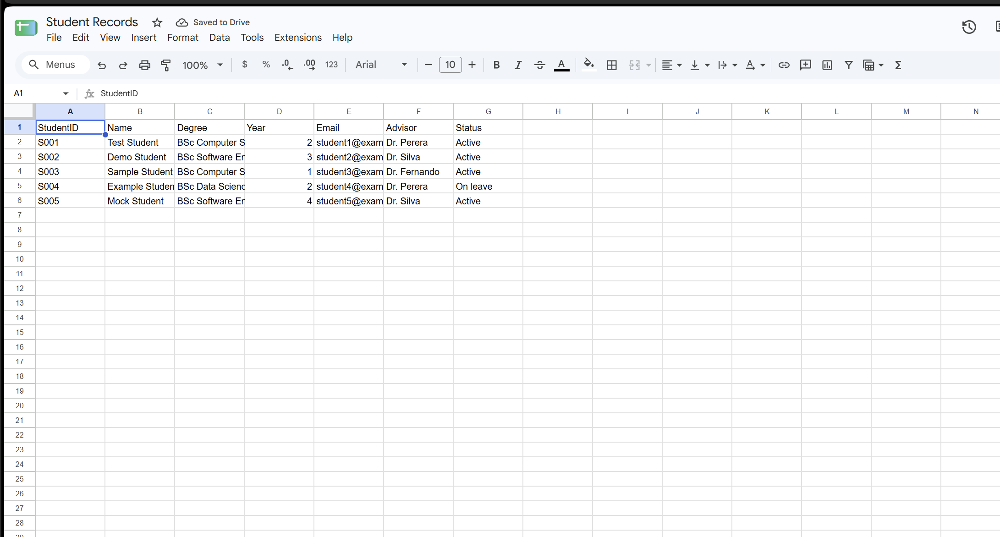
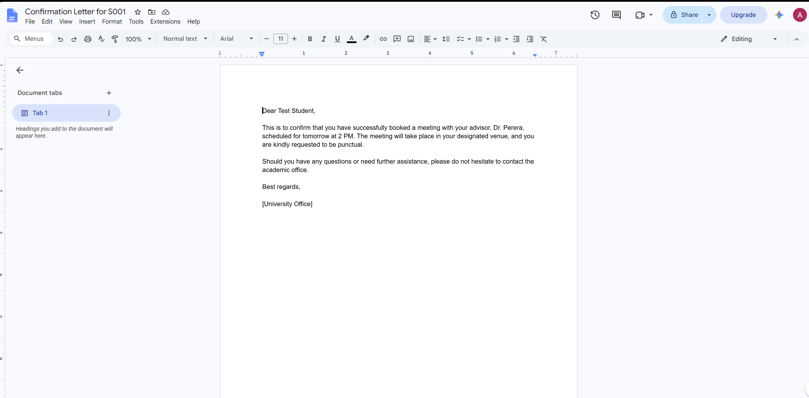

# Intelligent University Assistant (n8n)

A chat assistant for university staff and students. An AI agent answers questions from the university handbook (RAG), checks the calendar, reads and updates student records, writes documents and sends emails. It asks for approval before changing anything.

## Requirements and How They Are Met

| # | Requirement | Implementation |
|---|-------------|----------------|
| 1 | Chat interface | n8n **When chat message received** |
| 2 | AI Agent | n8n **AI Agent** with Ollama (Qwen3 8B) |
| 3 | RAG | `rag_tool.py` + `rag_server.py`, called by `search_university_info` |
| 4 | Check calendar | Google Calendar `get_events` |
| 5 | Create events after approval | Google Calendar `create_event` |
| 6 | Student records | Google Sheets `get_student`, `update_student` |
| 7 | Documents | Google Docs `create_doc`, `update_doc` |
| 8 | Notifications | Gmail `send_email` |

## How It Works

Chat message -> AI Agent (Ollama + Simple Memory) -> picks a tool (RAG, Calendar, Sheets, Docs or Gmail) -> reply.

Actions that change data or send messages (`create_event`, `update_student`, `create_doc`, `update_doc`, `send_email`) ask "Shall I go ahead?" first. This rule is in `system-prompt.txt`.

## Files

| File | Purpose |
|------|---------|
| `rag_tool.py` | Builds and searches the document index |
| `rag_server.py` | Local server that n8n calls for search |
| `system-prompt.txt` | System message for the agent |
| `student-records.csv` | Sample student data (fake) |
| `test-questions.md` | Test conversation |
| `data/` | Handbook PDF |
| `n8n-workflow/` | Exported workflow |
| `screenshots/` | Results |

## Setup

1. Start n8n in Docker: `docker start n8n`
2. Pull the models:
   ```powershell
   ollama pull qwen3:8b
   ollama pull qwen3-embedding:0.6b
   ```
3. Build the knowledge base and start the server:
   ```powershell
   py -3.12 -m venv rag_env
   .\rag_env\Scripts\Activate.ps1
   pip install -r requirements.txt
   python rag_tool.py build
   python rag_server.py
   ```
4. In Google Cloud, enable the Calendar, Sheets, Docs, Drive and Gmail APIs, create an OAuth client, add yourself as a test user, and create the Google credentials in n8n.
5. Import `student-records.csv` into a Google Sheet named **Student Records**.
6. Import `n8n-workflow/workflow.json`, select your credentials and sheet, and paste `system-prompt.txt` into the AI Agent system message.
7. Test with `test-questions.md`.

## Tips

- Start a **new chat session** after errors, because old answers stay in memory.
- Tool nodes cannot be run alone. Test them from the chat.
- For `search_university_info`, use a query parameter named `q` with the value set to **Defined by agent**.

## Screenshots








## Limitations

- A local 8B model can sometimes choose the wrong tool.
- Approval depends on the model following the prompt.
- The knowledge base only covers the PDF provided.
- Student data is fake. Credentials are not included.